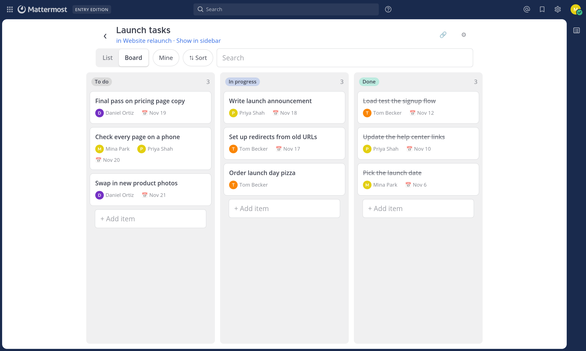
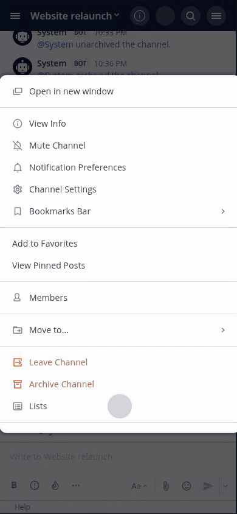
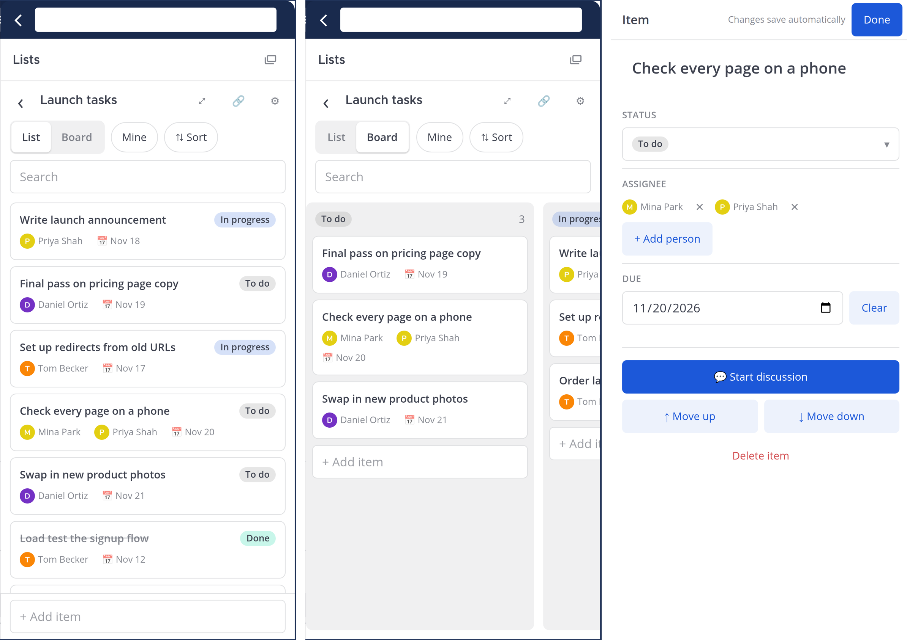
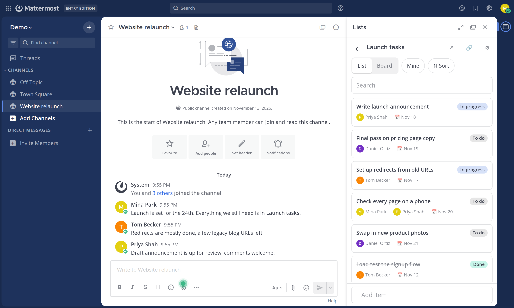

# MatterLists

Lightweight lists for Mattermost channels, designed for phone browsers first: tasks, checklists, issue trackers and inspection logs that live in the channel where the work is discussed.



**Why not Boards or Playbooks?** Those are bigger tools with their own spaces and workflows. MatterLists is for the small, shared list a channel keeps: it uses the channel's permissions, discussions are ordinary channel threads, and every screen is built to work in a phone browser.

**Install:** download the `.tar.gz` from the [latest release](https://github.com/BigForkLifter/matterlists/releases/latest) and upload it in **System Console → Plugins → Plugin Management**. Requires Mattermost 10.0+ on PostgreSQL.


- **Lists belong to a channel.** Members who can read the channel see its lists; members who can post can edit them.
- **Typed columns:** text, number, single select, multi-select, people, date, checkbox, link, and **Created by** (filled in automatically with whoever added the item; can be changed by hand or reset). Columns can be reordered in list settings. New lists start with Status, Assignee and Due.
- **List and Board views.** The board groups items by any single-select column. On phones it scrolls one column per swipe.
- **Drag and drop.** Drag cards to reorder them, or onto another board column to change their status. On phones, press and hold a card to pick it up. With a keyboard, Space picks a card up and drops it, and the arrow keys move it.
- **Discussions use Mattermost threads.** "Start discussion" posts a root message in the channel, so replies, mentions and notifications work as usual.
- **Add to list** from any message's actions menu.
- **Links to lists** (`/<team>/com.otules.matterlists/list/<id>`) go to the list's channel and open it in the sidebar. The 🔗 button copies one or adds it to the channel's bookmarks; ⤢ in the sidebar opens the list as a full page over the channel (‹ closes it).
- **Live updates** over WebSocket.
- **`/list` slash command** (`ls`, `show`, `new`, `add`) for the native mobile app, which can't load plugin UI.

## Screenshots

On a phone: press and hold a card to drag it up the list, then across to another board column.



List, board, and editing an item:



In the sidebar next to the channel:



## Where to find it

| Where | How |
|---|---|
| Desktop | App bar icon on the right, or the channel header |
| Phone browser | Channel name ▾ → **Lists**, or main menu → **Lists** |
| Mattermost mobile app | `/list` |

## Requirements

- Mattermost 10.0+
- PostgreSQL. The plugin refuses to activate on MySQL.

The plugin stores data in its own tables (`ml_lists`, `ml_columns`, `ml_items`), which it creates and migrates on activation.

## For administrators

- **Permissions.** A list follows its channel: anyone who can read the channel can read its lists, anyone who can post can edit them. There are no separate list permissions. Someone without access gets a 404, so a list's existence isn't revealed.
- **Removing someone from a channel or deactivating them** removes their access to its lists right away. Their name stays where they were assigned or listed as creator.
- **Archived channels.** Lists become read-only while the channel is archived.
- **Deleting a list** is a soft delete: its rows stay in the database.
- **Where data lives.** Everything, photos included, is in the Mattermost database, in tables prefixed `ml_`. Your normal database backup covers it; nothing goes to the file store.
- **Upgrades.** Schema migrations run when the plugin activates, under a Postgres advisory lock so cluster nodes don't race, and are recorded in `ml_migrations`.
- **Uninstalling** leaves the `ml_` tables in place, so reinstalling brings the lists back. Drop the tables yourself to remove the data.
- **Photo uploads** are re-encoded as JPEG (removing EXIF and GPS data) and capped at 25 MB or the server's maximum file size, whichever is smaller.
- **Notifications.** A bot account, `matterlists`, DMs people when someone else assigns them or @mentions them in an item.

## Development

```bash
make dist                                  # build the bundle in dist/
make deploy                                # upload to a server (set MM_SERVICESETTINGS_SITEURL and MM_ADMIN_TOKEN)
SKIP_DOCKER_TESTS=1 go test ./server/...   # server unit tests
cd webapp && npx jest && npm run lint && npx tsc
```

Integration tests (`server/integration_test.go`) start Mattermost and Postgres in Docker:

```bash
make dist MM_SERVICESETTINGS_ENABLEDEVELOPER=true DEFAULT_GOOS=linux DEFAULT_GOARCH=amd64
go test ./server -run TestListLifecycle
```

## Layout

- `server/store`: schema migrations, SQL, and cell value validation
- `server/api_lists.go`, `server/access.go`: REST API and permission checks
- `server/command`: the `/list` command
- `webapp/src/data.ts`: client cache with optimistic updates
- `webapp/src/components`: sidebar, list and board views, and sheets for editing on phones

## Not built yet

Due-date reminders, CSV import/export, and limits on items per list.

## Support

Built for and used on my own Mattermost server. Issues and pull requests are welcome, but there are no promises about fixes, features or response times.

## License

Apache License 2.0; see [LICENSE](LICENSE).

Mattermost is a trademark of Mattermost, Inc. This project is not affiliated with or endorsed by Mattermost, Inc.
